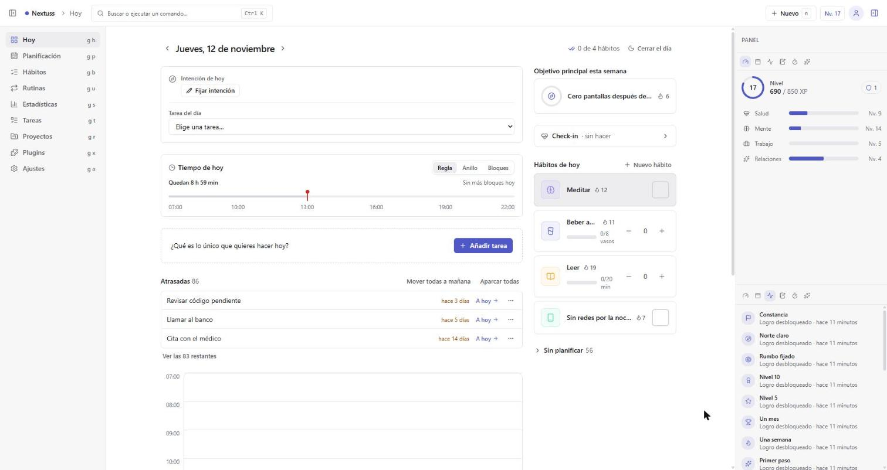
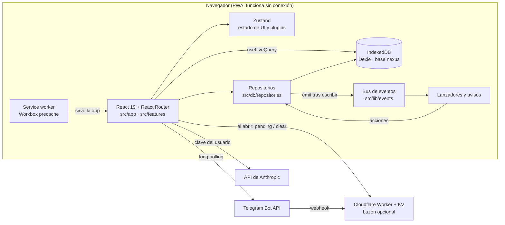

<div align="center">


# Nextuss

**Centro de mando personal: hábitos, tareas, objetivos y foco en un solo sitio.**

[](docs/ROADMAP.md)
[](LICENSE)
[](https://github.com/mkcodev/Nextuss/actions/workflows/ci.yml)
[](#-calidad)
[](https://react.dev)
[](https://www.typescriptlang.org)
[](https://vite.dev)
[](https://tailwindcss.com)
[](https://vitest.dev)

[Demo](https://nextuss.vercel.app) · [Documentación](docs/) · [Reportar un bug](https://github.com/mkcodev/Nextuss/issues/new?template=bug.md)

</div>

<picture>
  <source media="(prefers-color-scheme: dark)" srcset="docs/assets/hero-dark.jpg">
  
</picture>

<details>
<summary>🇬🇧 English summary</summary>

Nextuss is a personal command center that brings habits, tasks, goals, planning, focus sessions, check-ins and stats into one local-first web app.
Everything is connected: a task feeds a goal, a habit earns XP for an attribute.
Data lives in the browser (IndexedDB), works offline as an installable PWA and needs no account. The UI is in Spanish.
Built solo with React 19, TypeScript, Vite and Dexie, with 591 passing tests and CI on every pull request.

</details>

## Contenido

- [¿Por qué existe?](#-por-qué-existe)
- [Funcionalidades](#-funcionalidades)
- [Stack](#-stack)
- [Arquitectura](#-arquitectura)
- [Decisiones técnicas](#-decisiones-técnicas)
- [Calidad](#-calidad)
- [Desarrollo con IA](#-desarrollo-con-ia)
- [Empezar](#-empezar)
- [Roadmap](#-roadmap)
- [Autor](#-autor)
- [Licencia](#-licencia)

## 🎯 ¿Por qué existe?

Hábitos, tareas, planificación y foco suelen vivir en apps distintas. Saltar entre ellas cuesta tiempo y rompe el hilo del día.

Nextuss los junta y los conecta en un solo sitio. Capturar algo cuesta segundos, se maneja con teclado y el progreso se ve. Hoy lo usa su autor cada día; está pensado para cualquiera que quiera una herramienta personal de productividad sin cuenta ni backend.

## ✨ Funcionalidades

| Funcionalidad | Qué aporta | Estado |
|---|---|---|
| Captura rápida | Paleta <kbd>Ctrl</kbd>+<kbd>K</kbd>, atajos globales (<kbd>g</kbd> <kbd>h</kbd>, <kbd>j</kbd>/<kbd>k</kbd>, <kbd>n</kbd>) y bot de Telegram | Hecho |
| Tareas y proyectos | Capturar, ordenar, arrastrar y seguir el progreso por proyecto | Hecho |
| Hábitos | Rachas, recordatorios y registro diario | Hecho |
| Planificación | Calendario, bloques de tiempo y objetivos por día, semana y mes | Hecho |
| Foco y rutinas | Pomodoro y rutinas con pasos temporizados a pantalla completa | Hecho |
| Rituales del día | Check-in de energía, ánimo y foco, cierre de día y revisión semanal | Hecho |
| Gamificación | XP, niveles, atributos y logros conectados a tareas y hábitos | Hecho |
| Estadísticas | Resumen, hábitos, tiempo, insights e informes | Hecho |
| Plugins y lanzadores | Activar o desactivar cada módulo y reglas «cuando pase X, haz Y» | Hecho |
| IA opcional | Desglosar tareas y sugerir plan del día con la clave de Anthropic del usuario | Hecho |
| Telegram | Captura y avisos desde un bot propio, con relay opcional en Cloudflare | Hecho |
| PWA y copias | Instalable, funciona sin conexión y guarda copias en una carpeta local | Hecho |
| Diario y notas enlazables | Notas conectadas a tareas y objetivos | Pendiente |
| Sincronización | Datos entre dispositivos (proveedor sin decidir) | Pendiente |

> [!NOTE]
> Los datos viven solo en el navegador (IndexedDB). Sin sincronización, borrar los datos del sitio los borra. Por eso la app ofrece copias de seguridad en una carpeta local.

## 🧰 Stack

| Capa | Tecnología | Por qué |
|---|---|---|
| Frontend | React 19, React Router 7 | UI por componentes y rutas con `createBrowserRouter` |
| | Zustand | Estado de UI pequeño y sin ceremonia |
| | Tailwind CSS 4, Framer Motion, Lucide | Tokens de diseño, animaciones e iconos lineales |
| | Recharts, cmdk | Gráficas de estadísticas y paleta de comandos |
| | Three.js, React Three Fiber | Escenas del ritual de Virtualización |
| Datos | Dexie (IndexedDB) | Base local con consultas reactivas y migraciones versionadas |
| Backend opcional | Cloudflare Worker + KV | Buzón de mensajes de Telegram con la app cerrada |
| IA opcional | SDK de Anthropic | Llamadas desde el navegador con la clave del usuario |
| Testing y CI | Vitest, Testing Library, happy-dom, fake-indexeddb | Tests rápidos de lógica y de repositorios sin navegador |
| | GitHub Actions | Build, tests y lint en cada PR |
| Herramientas | Vite 8, TypeScript 6, Oxlint | Build rápido, tipado estricto y lint |
| | Workbox (vite-plugin-pwa), Vercel | Service worker con precache y despliegue |

## 🧱 Arquitectura



```text
.
├── src/
│   ├── app/          Shell: router, navegación, dock de paneles, atajos y paleta
│   ├── db/           Esquema Dexie, migraciones, repositorios, copias y datos de ejemplo
│   ├── design/       Primitivos de UI, iconos y tema claro/oscuro
│   ├── features/     24 módulos (tareas, hábitos, foco, plugins, IA, Telegram, estadísticas…)
│   ├── lib/          Lógica pura: XP, rachas, recurrencia, fechas y bus de eventos
│   ├── sw.ts         Service worker (precache de Workbox)
│   └── test/         Configuración común de Vitest
├── worker/           Relay opcional de Telegram (Cloudflare Worker + KV)
├── docs/             Flujo de trabajo, convenciones, arquitectura de plugins, roadmap y changelog
├── scripts/          Generación de iconos de la PWA
└── public/           Iconos y recursos estáticos
```

## 🧭 Decisiones técnicas

<details>
<summary><strong>1. Local-first con IndexedDB, sin backend ni cuenta</strong></summary>

- **Contexto:** hoy hay un solo usuario y se parte de una restricción: sin backend ni cuenta.
- **Decisión:** todos los datos van a IndexedDB con Dexie, y la app es una PWA instalable.
- **Consecuencia:** funciona sin conexión y no pide cuenta. A cambio no hay sincronización entre dispositivos; queda como fase pendiente con proveedor por decidir.

</details>

<details>
<summary><strong>2. Plugins con un único registro y sin borrar datos</strong></summary>

- **Contexto:** la app crece en módulos y no todos quieren todos.
- **Decisión:** `registry.ts` es la única lista de módulos. Cada pieza declara su `pluginId` y cada host (navegación, paleta, dock, avisos) filtra por él. El núcleo (Hoy, Tareas, Proyectos, Planificación) no se puede apagar.
- **Consecuencia:** desactivar un plugin nunca borra datos. Lo que aporta cada módulo se declara junto a su sitio con un `pluginId`.

</details>

<details>
<summary><strong>3. Bus de eventos y lanzadores con protección contra bucles</strong></summary>

- **Contexto:** se quieren automatizaciones «cuando pase X, haz Y» entre rutinas, tareas y plugins.
- **Decisión:** los repositorios emiten eventos tipados después de escribir. Un motor de lanzadores los escucha y ejecuta acciones. El emparejado es una función pura con límites: cadena máxima de 4 y tope diario de 20.
- **Consecuencia:** las reglas se pueden testear sin UI y no se encadenan sin fin. Con la app cerrada no se guardan eventos; los lanzadores de hora se recuperan al abrir.

</details>

<details>
<summary><strong>4. Relay de Telegram como buzón, no como servidor</strong></summary>

- **Contexto:** el bot solo recibe mensajes mientras la app está abierta, y el token del bot es sensible.
- **Decisión:** el Worker solo guarda mensajes en KV durante 7 días y los entrega. Nunca llama a la Bot API ni ve el token. Procesar comandos y responder sigue ocurriendo en la app.
- **Consecuencia:** el mismo código sirve para el polling en vivo y para el relay. Es opcional y se puede quitar sin perder funciones.

</details>

<details>
<summary><strong>5. Convención de carga y error en consultas reactivas</strong></summary>

- **Contexto:** `useLiveQuery` devuelve `undefined` mientras carga, y eso se confundía con «vacío».
- **Decisión:** `undefined` significa «cargando» y `null` significa «resuelto sin fila». Las listas que deciden un estado vacío pintan un `Skeleton` mientras cargan, y los errores suben a un límite de error.
- **Consecuencia:** una pantalla no muestra «Nada aquí» mientras todavía carga. Los getters nuevos nunca devuelven `undefined`. Ver [`docs/CONVENCIONES.md`](docs/CONVENCIONES.md).

</details>

## ✅ Calidad

- **Tests:** 591 pasan, en 78 archivos.[^1] Cubren lógica pura (XP, rachas, recurrencia, fechas, periodos), los repositorios de Dexie con `fake-indexeddb`, el bus de eventos, los validadores de IA y los comandos de Telegram.
- **CI:** [GitHub Actions](.github/workflows/ci.yml) ejecuta `npm run build` (incluye `tsc -b`), los tests y `npm run lint` en Node 22. Corre en cada pull request y en cada push a `main`.
- **Flujo:** issue, rama, pull request con `Closes #N`, CI en verde y squash merge. Hay 65 pull requests fusionadas. Ver [`docs/FLUJO.md`](docs/FLUJO.md).
- **Lint:** Oxlint termina sin errores; quedan avisos sin resolver, sobre todo en `.claude/` y `docs/design/`.
- **Rendimiento:** Recharts y el SDK de Anthropic se cargan bajo demanda (code-splitting).

<!-- TODO: añadir puntuaciones de Lighthouse cuando se midan sobre https://nextuss.vercel.app. -->

[^1]: Resultado de `npx vitest run` sobre `main` el 2026-11-12.

## 🤖 Desarrollo con IA

El proyecto se ha construido con [Claude Code](https://claude.com/claude-code). Esto es lo que consta en el repositorio:

- **Trazabilidad:** 19 commits llevan el trailer `Claude-Session` y 8 llevan `Co-authored-by: Claude`.
- **Flujo con revisión humana:** cada cambio nace en un issue, pasa por una rama y una pull request con plantilla, y solo se fusiona con CI en verde. Nada va directo a `main`.
- **Tests como red de seguridad:** build, tests y lint corren en cada PR. Las fases se cierran con los tres en verde ([`docs/ROADMAP.md`](docs/ROADMAP.md)).
- **Planificación previa:** las fases con diseño abierto se planifican antes de implementarse, con mockups de varias variantes en [`docs/design/`](docs/design/).
- **Configuración del agente:** `.claude/` versiona los agentes y skills usados en el proyecto.

## 🚀 Empezar

**Requisitos:** Node 22 y npm.

```bash
git clone https://github.com/mkcodev/Nextuss.git
cd Nextuss
npm ci
npm run dev
```

Otros comandos:

```bash
npm run build         # tsc -b + vite build
npm run test          # Vitest, una pasada
npm run lint          # Oxlint
npm run preview       # sirve el build
```

> [!TIP]
> En el primer arranque, elige «Ver con datos de ejemplo» para explorar la app con unos 6 meses de datos inventados que se pueden borrar después.

La app no lee variables de entorno, así que no hay `.env.example`. La clave de Anthropic y el token del bot de Telegram se introducen en **Ajustes** y se guardan en el navegador.

**Relay opcional de Telegram** (solo si quieres recibir mensajes con la app cerrada):

```bash
cd worker
npm install
npx wrangler kv namespace create NEXTUSS_KV   # pega el id en wrangler.toml
npx wrangler secret put SECRET
npm run deploy
```

| Variable | Dónde | Para qué |
|---|---|---|
| `SECRET` | Secreto de Cloudflare (`wrangler secret put`) | Parte secreta de la URL del relay |
| `NEXTUSS_KV` | Binding en `worker/wrangler.toml` | Namespace KV donde se guardan los mensajes pendientes |

> [!IMPORTANT]
> Desplegar el relay hace que Telegram reenvíe tus mensajes a tu cuenta de Cloudflare. Es opcional. La guía completa está en [`worker/README.md`](worker/README.md).

## 📍 Roadmap

- [x] Rediseño completo y sistema de diseño
- [x] Plugins con ficha de ajustes y valores por defecto
- [x] Lanzadores «cuando X, haz Y»
- [ ] Buscador de ajustes, presets y perfiles de plugins (PRs [#153](https://github.com/mkcodev/Nextuss/pull/153), [#155](https://github.com/mkcodev/Nextuss/pull/155), [#157](https://github.com/mkcodev/Nextuss/pull/157)) y vista previa en vivo de tema (PR [#159](https://github.com/mkcodev/Nextuss/pull/159))
- [ ] Test de entrada guiado para usuarios nuevos ([#100](https://github.com/mkcodev/Nextuss/issues/100))
- [ ] Ritual de salida al cerrar el día ([#101](https://github.com/mkcodev/Nextuss/issues/101))
- [ ] Dividir `TasksPage` y `TaskForm` ([#104](https://github.com/mkcodev/Nextuss/issues/104))
- [ ] Diario y notas enlazables ([#105](https://github.com/mkcodev/Nextuss/issues/105))
- [ ] Recompensas y gamificación ([#106](https://github.com/mkcodev/Nextuss/issues/106))
- [ ] Calendario ICS ([#107](https://github.com/mkcodev/Nextuss/issues/107))
- [ ] Sincronización con backend ([#108](https://github.com/mkcodev/Nextuss/issues/108))

Detalle completo en [`docs/ROADMAP.md`](docs/ROADMAP.md) y [`docs/CHANGELOG.md`](docs/CHANGELOG.md).

## 👤 Autor

**Mikel Salvador** · AI-Augmented Full-Stack Developer

[LinkedIn](https://linkedin.com/in/mkcodev) · [Web](https://mkcodev.com) · [info@mkcodev.com](mailto:info@mkcodev.com)

## 📄 Licencia

MIT. Ver [`LICENSE`](LICENSE).

---

<div align="center"><sub>Made with ❤️ by <a href="https://mkcodev.com">mkcodev</a> · AI-Augmented Full-Stack Developer</sub></div>
